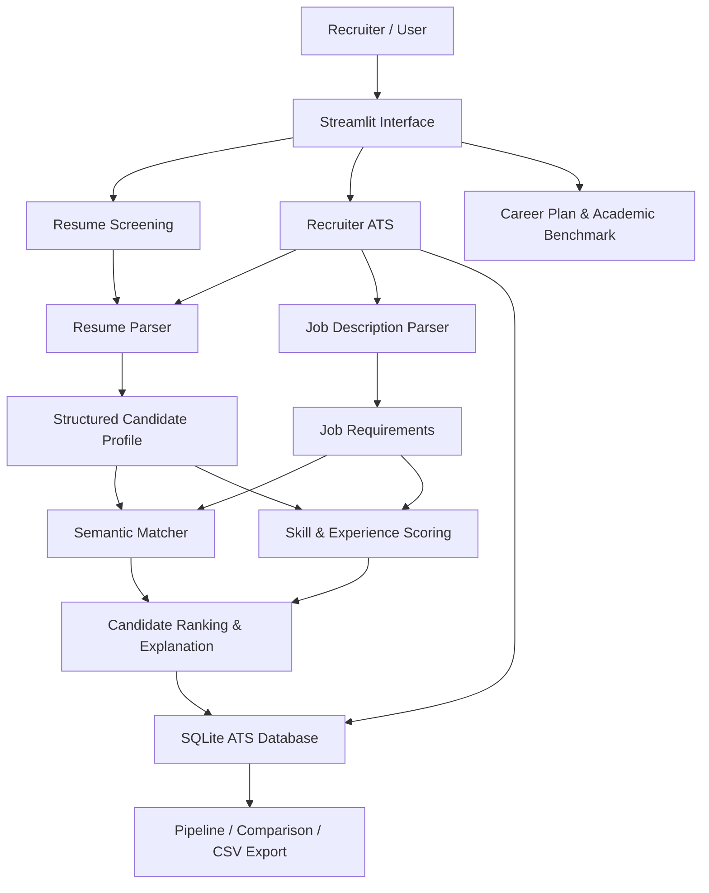

<!--
  HireSense AI
  README for the feature/recruiter-ats-upgrade branch
-->

<div align="center">

# HireSense AI

### Intelligent Resume Screening · Explainable Matching · Applicant Tracking

**Turn resume piles into structured, searchable candidate pipelines.**

An AI-assisted recruitment workspace for startups, small hiring teams, and project demonstrations — built with Python, Streamlit, NLP, and SQLite.

<br/>

[](https://www.python.org/)
[](https://streamlit.io/)
[](https://www.sbert.net/)
[](https://www.sqlite.org/)
[](LICENSE)

<br/>

[**Launch App**](https://ai-resume-screening-app-feature.streamlit.app/) ·
[**Project Website**](https://ai-resume-screening-app-feature.streamlit.app/) ·
[**Repository**](https://github.com/Stfu-diwakar/Ai-resume-screening-app)

<br/>

*Feature branch: `feature/recruiter-ats-upgrade`*

</div>

---

## ✨ At a glance

HireSense AI brings resume screening and applicant tracking into one place. Recruiters can import candidate documents, create job descriptions, compare candidate profiles against role requirements, apply structured filters, and move applicants through a hiring pipeline.

The project combines two connected workflows:

| Resume intelligence | Recruiter ATS |
|---|---|
| Resume parsing and profile extraction | Persistent candidate records |
| Semantic resume-to-JD matching | Multiple saved job descriptions |
| Explainable candidate scoring | Search, ranking, and structured filters |
| Skill-gap and career recommendations | Hiring pipeline and stage tracking |
| Academic model benchmarking | Candidate comparison and CSV export |

> **Design principle:** AI should help recruiters review evidence — not make hiring decisions for them. Scores are decision-support signals and must always be checked against the original resume.

---

## 📚 Contents

- [The problem](#-the-problem)
- [What HireSense offers](#-what-hiresense-offers)
- [Recruiter ATS walkthrough](#-recruiter-ats-walkthrough)
- [AI matching explained](#-ai-matching-explained)
- [Resume parsing and candidate data](#-resume-parsing-and-candidate-data)
- [Application architecture](#-application-architecture)
- [Technology stack](#-technology-stack)
- [Repository structure](#-repository-structure)
- [Run locally](#-run-locally)
- [Try the demo dataset](#-try-the-demo-dataset)
- [Testing checklist](#-testing-checklist)
- [Configuration and deployment](#-configuration-and-deployment)
- [Current scope and limitations](#-current-scope-and-limitations)
- [Privacy and responsible AI](#-privacy-and-responsible-ai)
- [Roadmap](#-roadmap)
- [Contributing](#-contributing)
- [Author](#-author)

---

## 🎯 The problem

Small companies and growing startups can receive hundreds of applications for a single opening. Manually opening every resume, extracting qualifications, comparing skills, and remembering interview stages takes time — and makes it easy to overlook relevant experience.

A useful small-scale ATS should make it possible to:

1. Collect multiple resumes in one import.
2. Convert documents into structured candidate profiles.
3. compare candidates against a specific job description.
4. Filter applicants using relevant, transparent criteria.
5. Keep hiring progress organized in one pipeline.
6. Give recruiters enough evidence to make their own decisions.

HireSense AI is designed as a practical prototype of that workflow.

---

## 🚀 What HireSense offers

### 1. Resume intelligence

- Parse resume documents and extract readable text.
- Identify candidate names and contact details where possible.
- Detect skills using the project's skill taxonomy.
- Segment common resume sections such as summary, experience, education, projects, skills, and certifications.
- Estimate experience from recognizable experience statements and date ranges.
- Generate candidate-to-job relevance scores.
- Surface matched skills, missing skills, and relevant resume evidence.

**Supported document formats:** the parser supports PDF, DOCX, and TXT. The Recruiter ATS bulk-upload control currently accepts PDF and DOCX files.

### 2. Recruiter ATS workspace

The ATS workspace adds a recruiter-oriented workflow on top of the original screening application.

| Workspace area | What it does |
|---|---|
| **Overview & Ranking** | Select a role, rank candidates, inspect score components, and apply filters |
| **Import Resumes** | Upload multiple PDF/DOCX files and review import results |
| **Jobs** | Create and save job descriptions for different openings |
| **Pipeline** | Move candidates through hiring stages |
| **Compare & Export** | Compare candidate profiles and download candidate data as CSV |

### 3. Candidate filters

Recruiters can narrow the candidate list using:

- Match score
- Hiring stage
- Skills and technologies
- Years of experience
- Location
- 10th percentage
- 12th percentage
- CGPA
- Graduation-year range

Academic and profile fields are best-effort extractions. A missing value is kept blank; it should not be interpreted as zero or as evidence that a candidate does not qualify.

### 4. Hiring pipeline

Track candidate progress through the following stages:

```text
Applied → Shortlisted → Interview → Offer
                    └──────────────→ Rejected
```

Stage updates are stored in the ATS database with timestamps and activity records.

### 5. Candidate comparison and export

- Select up to three candidates for a side-by-side profile comparison.
- Review contact information, experience, education fields, location, stage, and skills.
- Export the candidate list to CSV for offline review and reporting.
- View email addresses for shortlisted candidates to prepare recruiter communication.

### 6. Additional AI and analysis features

- **Semantic matching:** contextual comparison using Sentence-BERT.
- **TF-IDF baseline:** lexical similarity model for fallback and academic comparison.
- **Explainable scoring:** show matching components instead of presenting only a black-box result.
- **Skill-gap insights:** identify required and preferred skills that are not detected in a resume.
- **Career recommendations:** suggest learning directions and portfolio project ideas.
- **Academic benchmarking:** compare semantic and TF-IDF approaches using evaluation utilities.
- **Duplicate checks:** avoid importing an identical file twice and flag matching email addresses.

---

## 🧭 Recruiter ATS walkthrough

The following is the recommended end-to-end workflow for a hiring team.

### Step 1 — Create a job

Open **Recruiter ATS → Jobs**.

- Enter a role title.
- Paste the full job description.
- Save the role.
- Create additional roles for other openings when needed.

The job description parser is used to identify role skills and experience requirements.

### Step 2 — Import resumes

Open **Recruiter ATS → Import Resumes**.

- Select multiple PDF or DOCX files.
- Start the bulk import.
- Review how many profiles were added, skipped as duplicates, or reported with errors.

Each readable resume is parsed separately. An issue with one document should be reported for that file rather than silently treated as a successful import.

### Step 3 — Rank candidates

Open **Recruiter ATS → Overview & Ranking**.

- Select the job you want to recruit for.
- Review candidates ranked by their calculated match score.
- Set a minimum match score.
- Filter by stage, skill, location, experience, academic values, and graduation year.
- Open a candidate to inspect the score breakdown and detected skill gaps.

### Step 4 — Move candidates through the pipeline

Use **Recruiter ATS → Pipeline** to update the candidate's stage:

- Applied
- Shortlisted
- Interview
- Offer
- Rejected

Updates are persisted in SQLite and reflected in the pipeline view.

### Step 5 — Compare and export

Open **Recruiter ATS → Compare & Export**.

- Select two or three candidates to compare their available profile fields.
- Download the candidate database as a CSV file.
- Use shortlisted email addresses to prepare communication in your approved mail client.

**Note:** the current application prepares shortlisted email addresses; it does not send bulk emails automatically.

---

## 🧠 AI matching explained

HireSense uses semantic similarity and structured matching signals to help compare a resume with a job description.

### Sentence-BERT semantic similarity

The default embedding model is:

```text
sentence-transformers/all-MiniLM-L6-v2
```

Sentence-BERT converts text into dense vector representations. Cosine similarity is then used to estimate how contextually related the job description and resume are.

This helps identify related language even when the resume and job description do not use exactly the same wording.

### Recruiter ATS score

The Recruiter ATS ranking currently uses these default weights:

| Matching component | Weight | Purpose |
|---|---:|---|
| Semantic similarity | 35% | Contextual relevance between the job description and resume |
| Skill coverage | 50% | Coverage of required and preferred skills |
| Experience alignment | 15% | Alignment with the experience requirement |

The score is calculated as:

```text
ATS Score =
    (0.35 × Semantic Similarity)
  + (0.50 × Skill Coverage)
  + (0.15 × Experience Alignment)
```

Each component is normalized to a 0–100 scale before the weighted score is calculated.

**Important scoring notes**

- Required and preferred skills are compared against skills detected in the candidate profile.
- Experience alignment is based on the experience estimate and the role's parsed minimum experience requirement.
- If a role does not specify a minimum experience requirement, experience alignment does not penalize the candidate.
- If the job parser does not identify skill requirements, skill coverage should be interpreted cautiously.
- The score is not a probability of selection, job performance, or future success.
- Ranking depends on the quality of the source resume and the job description.

### Original screening score

The original screening workspace also supports configurable scoring weights for semantic similarity, skills, and project/experience evidence.

Default configuration:

| Signal | Default weight |
|---|---:|
| Semantic similarity | 40% |
| Skills | 40% |
| Project and experience evidence | 20% |

The sidebar provides weight presets and custom controls for this screening workflow.

### TF-IDF fallback

When Sentence-Transformers cannot load its embedding model, the semantic matcher falls back to TF-IDF vectorization with cosine similarity. This keeps basic text matching available, although TF-IDF is lexical rather than contextual.

---

## 📄 Resume parsing and candidate data

The parser is designed to handle common resume layouts and extract useful information from text-based documents.

| Profile field | Extraction approach |
|---|---|
| Candidate name | Header heuristics and optional spaCy entity extraction |
| Email | Regular-expression pattern |
| Phone | Pattern extraction with digit-length validation |
| LinkedIn / GitHub | Profile URL pattern detection |
| Skills | Project skill taxonomy |
| Experience | Experience phrases and date-range heuristics |
| Resume sections | Recognized section headings |
| Academic fields in ATS | Label-based percentage, CGPA, and year patterns |
| Location in ATS | Best-effort labelled location extraction |

The extracted profile should always be treated as a draft. Resume layouts vary widely, so recruiters should verify important information against the original document.

### Duplicate detection

The ATS uses two simple duplicate checks:

1. **File fingerprint:** SHA-256 hash of the uploaded file bytes.
2. **Email match:** case-insensitive comparison when an email address is available.

These checks are useful for repeated imports, but they do not guarantee person-level identity resolution. A candidate can submit a revised resume with a different file hash, and shared or mistyped email addresses can create false matches.

---

## 🏗️ Application architecture

HireSense is organized as a Streamlit application with reusable Python modules and a local SQLite database.



### Main components

| Component | Responsibility |
|---|---|
| `app.py` | Streamlit application entry point and navigation |
| `config.py` | Data paths, model names, and default scoring configuration |
| `modules/parser.py` | Resume and job-description text extraction |
| `modules/taxonomy.py` | Skill vocabulary and extraction |
| `modules/semantic_matcher.py` | Sentence-BERT, cosine similarity, and TF-IDF baseline |
| `modules/scoring.py` | Original screening score calculation |
| `modules/explainable_ai.py` | Match explanations and evidence helpers |
| `modules/recommender.py` | Career and skill recommendations |
| `modules/database.py` | Original screening history persistence |
| `modules/academic_eval.py` | Academic model evaluation |
| `modules/recruiter_workspace.py` | ATS database, recruiter filters, pipeline, comparison, and export |

### Data storage

The project uses SQLite at:

```text
data/hiresense.db
```

The ATS initializes its own tables for:

- Candidate profiles
- Saved job descriptions
- Candidate stage activity

The original screening history uses the existing database module. The database is local to the application instance and is not a multi-tenant production database.

---

## 🧰 Technology stack

| Layer | Tools |
|---|---|
| Programming language | Python 3.10+ |
| Web application | Streamlit |
| Semantic NLP | Sentence-Transformers / Sentence-BERT |
| Text similarity | Scikit-learn, TF-IDF, cosine similarity |
| NLP utilities | spaCy, regular expressions |
| PDF parsing | PyMuPDF |
| DOCX parsing | python-docx |
| Data processing | Pandas, NumPy |
| Visualization | Plotly |
| Persistence | SQLite |
| Export | CSV |

---

## 📁 Repository structure

```text
Ai-resume-screening-app/
│
├── app.py
├── config.py
├── requirements.txt
├── test_pipeline.py
├── create_sample_docs.py
│
├── assets/
│   └── style.css
│
├── modules/
│   ├── parser.py
│   ├── taxonomy.py
│   ├── semantic_matcher.py
│   ├── scoring.py
│   ├── explainable_ai.py
│   ├── recommender.py
│   ├── database.py
│   ├── academic_eval.py
│   └── recruiter_workspace.py
│
└── data/
    ├── sample_jobs/
    ├── sample_resumes/
    └── hiresense.db  # created/used at runtime
```

The SQLite database is generated or initialized when the application runs; do not commit a production database containing candidate information.

---

## ⚡ Run locally

### Prerequisites

- Python 3.10 or newer
- Git
- Internet access for installing packages and, on first use, downloading the Sentence-Transformers model if it is not already cached

### 1. Clone the repository

To use the recruiter ATS upgrade branch:

```bash
git clone --branch feature/recruiter-ats-upgrade --single-branch https://github.com/Stfu-diwakar/Ai-resume-screening-app.git
cd Ai-resume-screening-app
```

Or, if you have already cloned the repository:

```bash
git fetch origin
git checkout feature/recruiter-ats-upgrade
git pull origin feature/recruiter-ats-upgrade
```

### 2. Create a virtual environment

**Windows PowerShell**

```powershell
python -m venv .venv
.venv\Scripts\Activate.ps1
```

**macOS / Linux**

```bash
python3 -m venv .venv
source .venv/bin/activate
```

### 3. Install dependencies

```bash
python -m pip install --upgrade pip
pip install -r requirements.txt
```

### 4. Start the application

```bash
streamlit run app.py
```

Open the local address shown in your terminal. The default is:

[`http://localhost:8501`](http://localhost:8501)

### 5. Run the existing pipeline test

```bash
python test_pipeline.py
```

The test script covers the existing screening pipeline. Use the manual ATS checklist below to verify recruiter workflows as well.

### First model load

The Sentence-Transformers model may need to download the first time it is used. Model loading can take longer on the first run. If the embedding model is unavailable, the semantic matcher has a TF-IDF fallback.

---

## 🧪 Try the demo dataset

The repository includes synthetic resume and job-description examples for trying the application without importing real candidate information.

### Included sample job descriptions

- Full Stack Engineer
- Senior ML Engineer
- Python Developer
- Business Analyst
- Project Manager

### Included sample resumes

The sample resume folder contains synthetic candidate examples in PDF, DOCX, and TXT formats, including examples for:

- Senior Machine Learning
- DevOps
- Junior / internship
- Full Stack
- Data Science

### Load demo data from the app

1. Start HireSense AI.
2. Open **Recruiter ATS → Jobs**.
3. Select **Import included sample job descriptions**.
4. Open **Import Resumes**.
5. Select **Load included demo resume dataset**.
6. Return to **Overview & Ranking** and select a sample role.

The demo resume loader chooses one document per sample filename stem to avoid importing the PDF and DOCX copies of the same synthetic example as separate profiles. The parser and bulk upload can still be tested independently with either format.

---

## ✅ Testing checklist

Use the following checks before demonstrating or deploying a change.

| Area | Test | Expected behavior |
|---|---|---|
| Resume import | Upload multiple valid PDF/DOCX files | Each readable file is parsed and imported |
| Resume import | Upload an identical file again | Duplicate is skipped |
| Resume import | Upload a corrupt or unsupported document | A file-level error is displayed |
| Resume import | Upload a scanned PDF | Text extraction may be empty; user is warned |
| Job management | Save multiple JDs | Saved roles appear in the Jobs workspace |
| Ranking | Change selected role | Scores are calculated against that role |
| Filters | Apply skill, location, and experience filters | Candidate list narrows accordingly |
| Academics | Apply marks or CGPA filters | Missing values are not silently treated as a pass |
| Pipeline | Move a candidate to another stage | New stage remains after rerun |
| Comparison | Select two or three candidates | Selected profiles appear in comparison |
| Export | Download candidate CSV | CSV contains available profile and stage fields |
| Existing app | Open original screening and benchmark tabs | Existing workflows remain accessible |

For repeatable evaluation, create a small test set with varied resume layouts, overlapping skills, synonyms, different experience levels, missing academic values, and duplicate documents.

---

## 🚢 Configuration and deployment

### Configuration

Application paths and model defaults are centralized in `config.py`.

| Setting | Purpose |
|---|---|
| `BASE_DIR` | Project root directory |
| `DATA_DIR` | Local data directory |
| `SAMPLE_RESUMES_DIR` | Synthetic resume examples |
| `SAMPLE_JOBS_DIR` | Sample job descriptions |
| `DB_PATH` | SQLite database path |
| `DEFAULT_EMBEDDING_MODEL` | Default Sentence-Transformers model |
| `DEFAULT_WEIGHT_*` | Original screening score weights |

### Deployment notes

The app can be deployed to a Streamlit-compatible hosting platform, provided the dependencies and data paths are configured correctly.

Before deploying:

1. Install all dependencies from `requirements.txt`.
2. Confirm the Sentence-Transformers model can be downloaded or loaded from cache.
3. Ensure the host has writable storage if SQLite persistence is required.
4. Do not rely on an ephemeral filesystem for candidate records.
5. Keep real resumes and candidate data out of the public Git repository.
6. Add authentication and access controls before allowing a real hiring team to use the system.

**SQLite deployment warning:** local SQLite is appropriate for a prototype and small single-instance demo. A host may replace ephemeral files during restart or redeployment. For persistent, concurrent, multi-user use, migrate to a managed database such as PostgreSQL and use persistent object storage for documents.

---

## ⚠️ Current scope and limitations

HireSense AI is a learning, portfolio, and prototype ATS. The following capabilities are not yet production-grade or are not implemented in the current branch.

| Area | Current status |
|---|---|
| PDF/DOCX bulk resume upload | Implemented in Recruiter ATS |
| TXT parsing | Supported by the parser; not in ATS bulk uploader |
| Resume text extraction | Implemented for text-based documents |
| OCR for scanned PDFs | Not implemented |
| Candidate profile extraction | Best-effort parsing; manual verification needed |
| Academic field extraction | Heuristic and label-dependent |
| Role-based ranking | Implemented with weighted matching signals |
| Candidate filters | Implemented for listed ATS fields |
| Hiring pipeline | Implemented with SQLite persistence |
| Duplicate detection | File hash and email-based checks |
| Candidate comparison | Implemented for up to three candidates |
| CSV export | Implemented |
| Bulk email delivery | Not implemented; addresses can be copied for external use |
| Recruiter login and permissions | Not implemented |
| Multi-tenant organization support | Not implemented |
| Production audit/compliance controls | Not implemented |
| Large-scale background processing | Not implemented |

---

## 🔐 Privacy and responsible AI

Resumes contain personal information. Use synthetic or consented documents when testing and follow applicable privacy and employment laws when handling real candidate data.

Recommended safeguards for any real deployment:

- Obtain an appropriate legal basis and notice before processing candidate information.
- Limit access to resumes and candidate profiles to authorized people.
- Define retention periods and deletion procedures.
- Do not commit resumes, contact details, database files, or secrets to source control.
- Avoid collecting or using protected characteristics or sensitive personal data for ranking.
- Review parsed fields against original documents.
- Keep a human reviewer involved in every screening decision.
- Do not reject or shortlist a candidate solely because of an automated score.
- Periodically evaluate matching quality across different resume formats and candidate groups.

AI matching can reflect missing information, parser errors, and bias in source data. A high score is not proof of suitability, and a low score is not proof that a candidate is unsuitable.

---

## 🗺️ Roadmap

The following ideas would move the prototype closer to a production-oriented ATS:

- [ ] OCR support for scanned resumes
- [ ] More reliable education, institution, and graduation-year extraction
- [ ] Candidate-level duplicate detection with configurable confidence and recruiter review
- [ ] Editable candidate profiles and resume preview
- [ ] Search across candidate names, email, skills, and experience
- [ ] Interview scheduling and structured interviewer feedback
- [ ] Configurable hiring stages and activity history
- [ ] Email provider integration with templates, consent checks, and delivery logs
- [ ] Recruiter authentication and role-based permissions
- [ ] PostgreSQL database and persistent document storage
- [ ] Background jobs for large resume batches
- [ ] Automated unit and integration tests for parser, scoring, filters, and pipeline
- [ ] Candidate data export, deletion, and retention management
- [ ] Matching quality and fairness evaluation tools

---

## 🤝 Contributing

Contributions, bug reports, and practical suggestions are welcome.

1. Fork the repository.
2. Create a focused feature branch.
3. Make the change and add tests where appropriate.
4. Run the existing test pipeline.
5. Open a pull request describing the change and how it was verified.

When reporting a bug, include the Python version, operating system, relevant error output, and steps to reproduce it. Do not attach real candidate resumes or personal information.

---

## 👨‍💻 Author

<div align="center">

### Diwakar Jha

MCA — Artificial Intelligence & Machine Learning  
Chandigarh University

[](https://github.com/Stfu-diwakar)
[](https://www.linkedin.com/in/diwakar-jha-064130229/)
[](https://dwkr.lovable.app/)

</div>

---

<div align="center">

**HireSense AI**

*Less manual screening. More structured hiring. Clearer candidate insights.*

If you find this project useful, consider giving the repository a ⭐.

</div>
